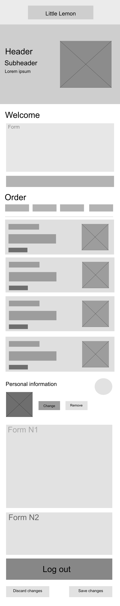

# Little Lemon Food Ordering

A small React Native capstone app built with Expo. First launch opens onboarding; the home screen includes the restaurant hero, menu search, category filters, and dish summaries. Profile edits and notification preferences are saved on device and remain available after relaunch. Logging out clears the saved profile and returns to onboarding.

## Run

Install dependencies, then run `npx expo start` from the project folder and open the app in Expo Go or a simulator.

## Project structure

- `App.js` is the app entry point; `src/AppContent.js` loads and manages the saved profile.
- `src/navigation/` defines the onboarding, home, and profile stack.
- `src/screens/` contains the screen-level UI and interactions.
- `src/components/` contains shared UI such as the header, form fields, hero, and notification controls.
- `src/data/`, `src/constants/`, and `src/storage/` hold menu/profile defaults, theme values, and AsyncStorage helpers.

## Screens and wireframe

See [WIREFRAME.md](./WIREFRAME.md) for the screen layouts this app follows.

## Possible improvements

- Add a real avatar picker and restaurant/menu images bundled with the app.
- Add cart, checkout, order tracking, and dietary/allergen details.
- Add stronger email validation and account sync if the app later has a backend.
